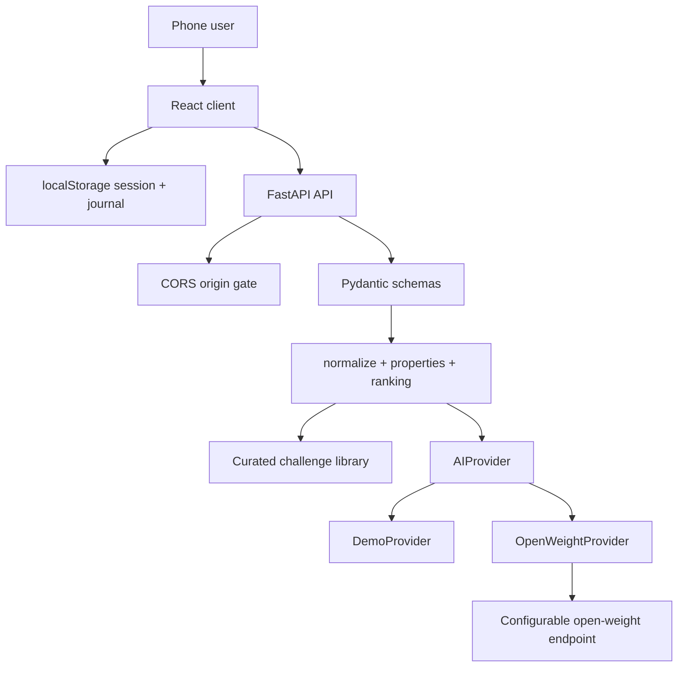

# NO-KIT Architecture

## Principles

1. The physical experiment is the product. The screen is orchestration.
2. Demo Mode must work without a model key, database, or network inference.
3. The frontend owns presentation and local session progress.
4. The backend owns model calls, secrets, validation, safety, and challenge ranking.
5. Hidden solutions never cross the public challenge boundary before completion.
6. Every challenge must be safe, feasible with available materials, and educational.

## Runtime topology



## Frontend ownership

`src/main.tsx` currently contains the shared screen state machine:

```text
home
→ explore / journal
→ scan
→ challenges
→ mission
→ build
→ attempt
→ outside
→ result
→ discovery
→ shelf
```

The next state additions are prediction and observation journal fields, not duplicated pages. Shared components should continue to serve all curated challenges.

`src/api.ts` owns:

- browser image compression
- public API URL resolution
- material detection request
- demo material fallback
- future challenge, attempt, hint, and discovery calls

`src/styles.css` owns base layout and the primary visual language. `src/polish.css` owns tactile interaction, responsive adjustments, blue/aqua palette, and motion overrides.

## Local state model

The MVP can persist a session in localStorage:

```ts
type BuildSession = {
  challengeId: string
  materials: Material[]
  attempts: number
  hintsUsed: number
  prediction?: string
  observation?: string
  attemptPhotos?: string[]
  startedAt: string
  completedAt?: string
  discovered: boolean
}
```

Images should remain previews or compressed data only for the local MVP. A future hosted version should use short-lived object storage URLs rather than putting large base64 payloads into localStorage.

## Backend modules

### `server/main.py`

- creates the FastAPI app
- configures CORS
- selects the provider from environment variables
- exposes health and AI orchestration routes
- catches provider failures and falls back when Demo Mode is enabled

### `server/main_models.py`

Contains separate private and public schemas. `Challenge` includes `hiddenSolution` for backend reasoning. `PublicChallenge` explicitly excludes it. Requests and responses are validated before reaching the provider boundary or frontend.

### `server/challenges.py`

Contains the curated library and deterministic reasoning layer:

```text
material names
→ aliases and normalization
→ property map
→ feasible candidates
→ forbidden/safety filter
→ learning score
→ outside score
→ ranked best three
```

This layer is intentionally deterministic so a judge gets reliable output even when a model is unavailable.

## Provider contract

```python
class AIProvider(Protocol):
    def detectMaterials(image: str) -> DetectionResponse: ...
    def generateChallenges(materials: list[str]) -> list[Challenge]: ...
    def evaluateAttempt(image: str, challenge: Challenge, result: str | None = None) -> dict: ...
    def generateHint(context: HintRequest) -> dict: ...
    def explainDiscovery(context: DiscoveryRequest) -> dict: ...
```

### DemoProvider

Returns stable material detections, curated ranked challenges, short hints, and Wind Hacker explanations. It is the default in `.env.example` and should remain usable in production judging.

### OpenWeightProvider

Calls an OpenAI-compatible `/chat/completions` endpoint. It accepts a vision model for image requests and a text model for ranking and tutoring. It parses JSON content, validates it with Pydantic, and raises controlled errors on timeout, invalid JSON, or unavailable endpoints.

No provider credential is ever sent to the browser.

## Safety boundary

The provider and curated library must reject or avoid:

- fire and explosions
- weapons or harmful projectiles
- mains electricity or dangerous voltage
- dangerous chemistry
- unsafe ingestion
- climbing or dangerous heights
- experiments that could harm people, animals, or property

Water Filter Experiment output is never described as drinkable. Outdoor instructions avoid mandatory geolocation and keep learners in familiar safe spaces.

## Deployment

Render runs two services from `render.yaml`:

```text
no-kit-api
  rootDir: server
  build: pip install -r requirements.txt
  start: uvicorn main:app --host 0.0.0.0 --port $PORT

no-kit-client
  build: npm install && npm run build
  publish: dist
```

`VITE_API_URL` is a build-time public URL. `AI_API_KEY` is an API-service-only secret. `DEMO_MODE=true` is the production judge fallback.

## Validation strategy

```bash
npm run build
cd server
python -m py_compile main.py challenges.py main_models.py
curl http://localhost:8000/health
```

Reasoning tests should cover at least fifteen material combinations. Provider tests should cover valid output, invalid JSON, timeouts, offline endpoints, unreadable images, safety filtering, and hidden-solution redaction.