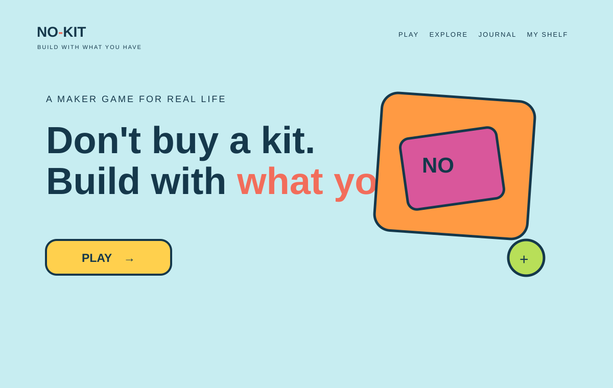
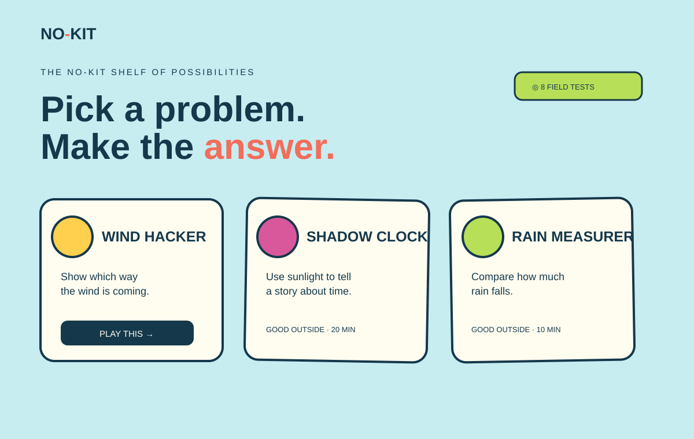
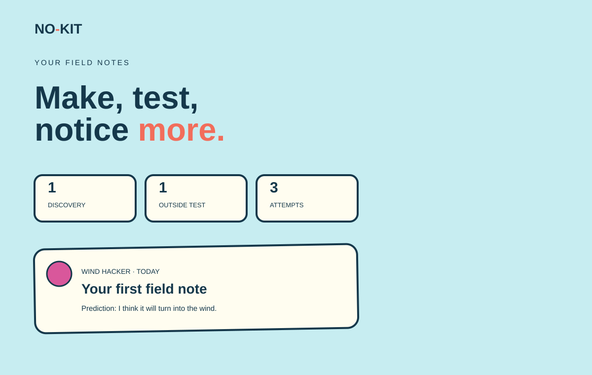
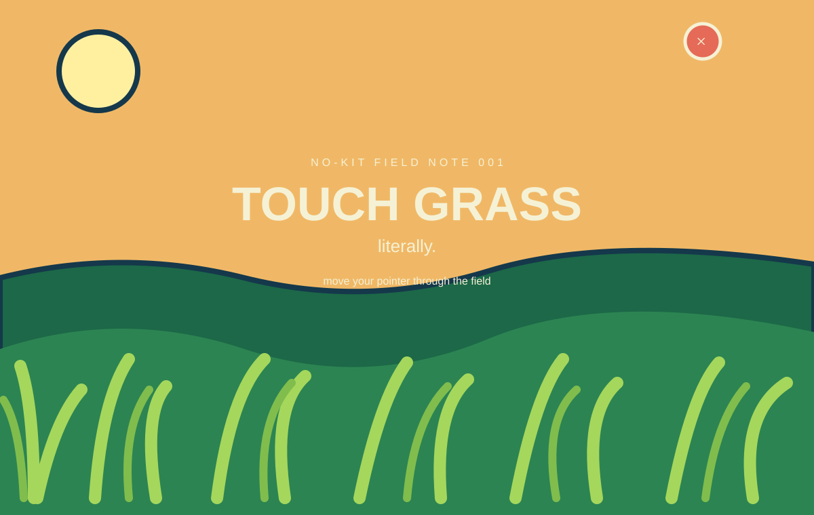
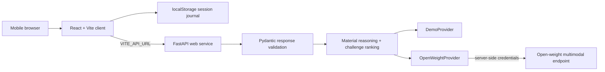

# NO-KIT

> Don't buy a kit. Don't watch a tutorial. Build it.

NO-KIT is a mobile-first maker game that turns ordinary objects into real science. A learner photographs what is nearby, receives a challenge framed as a problem, builds without a tutorial, predicts what will happen, tests the object in the real world, and gets one useful hint at a time.

The screen should be the shortest part of the experience.

## Website previews

These checked-in example previews document the intended website surfaces. The real UI is rendered by React and remains interactive at the local `/demo` route.

### Home and primary action



### Explore challenge library



### Field Journal



### Hidden Grass Mode



The previews are original project UI references, not copied assets. Grass Mode is an interactive red-herring screen opened from the grass-shaped button in the top-left corner. For runtime screenshots, run the app locally and capture `/demo`, `/explore`, `/journal`, and Grass Mode at desktop and mobile widths.

## Product promise

Within 15 seconds, a new user should understand:

```text
I show NO-KIT what I have.
It challenges me to build something.
I figure it out.
I test it in the real world.
AI helps me learn from the experiment.
```

NO-KIT is not an activity feed, tutorial library, chatbot, or SaaS dashboard. It is a Socratic maker tutor wrapped around a physical build-test-learn loop.

## The complete learner loop

```text
LOOK
  ↓
CHALLENGE
  ↓
PREDICT
  ↓
BUILD
  ↓
SHOW THE ATTEMPT
  ↓
GO OUTSIDE
  ↓
OBSERVE
  ↓
GET ONE HINT
  ↓
ITERATE
  ↓
DISCOVER
  ↓
UNDERSTAND
  ↓
SAVE TO MY SHELF
```

The default judging path is **Wind Hacker**. The learner must build something that can show wind direction. The final name, wind vane, stays hidden until success.

## User experience

### 1. Home

Shows the NO-KIT identity, the short promise, and one primary `PLAY` action. The user can also open `MY SHELF`. Music is optional and starts only when browser policy allows it or after the first user gesture.

### 2. Material Scan

The user can take a mobile camera photo or select a gallery image. The client compresses the image before sending it to the backend. The screen shows:

- loading/scanning state
- preview image
- detected material chips
- confidence-backed detections
- remove controls for wrong detections
- manual add control for missing materials
- retry and error state

Demo Mode starts with a curated cardboard, straw, pencil, tape, and paper pile so a judge can continue without a camera or API key.

### 3. Challenge Reveal

The backend ranks feasible, safe, educational challenges from the materials. The frontend presents a small set of collectible cards. A card describes the problem, never the hidden answer.

### 4. Mission Intro

Shows the chosen mission, available materials, constraints, and a short safety reminder. No tutorial steps are shown.

### 5. Build Mode

The UI intentionally says “Put your phone down.” The user can:

- mark the build as ready
- ask for Hint 1
- progressively request Hint 2 and Hint 3
- never receive the full solution before discovery

### 6. Attempt Photo

The user can show a photo of the physical object. The client previews it locally. The backend can evaluate whether the attempt looks testable without grading the learner like a classifier.

### 7. Outside Mode

This is deliberately sparse. It tells the learner to put the phone away, find a safe testing place, and observe the object.

### 8. Prediction and Observation

Before testing, the learner records what they think will happen. After testing, they record what actually happened. This is the science journal core of the product.

### 9. Iteration

The learner selects a result such as “worked,” “moved but did not settle,” “did not move,” or “broke.” A failed result returns one next-step hint and increments the attempt count.

### 10. Discovery

After success, the hidden object name is revealed with a short explanation and a small list of concepts. The learner can expand a brief “Why?” explanation.

### 11. My Shelf

Completed objects become collectible build cards. The shelf stores the object, materials, science concepts, time, attempt count, and observations locally.

## Current challenge library

Every challenge has materials, a mission, a hidden solution, concepts, difficulty, duration, outside requirement, safety constraints, success criteria, three hints, a test protocol, and a completion explanation.

| Challenge | Hidden solution | Main ideas | Outside |
| --- | --- | --- | --- |
| Wind Hacker | Wind vane | wind, force, surface area, aerodynamics | Required |
| Shadow Clock | Sundial | sunlight, shadows, Earth rotation, time | Required |
| Rain Measurer | Rain gauge | precipitation, measurement, scale | Required |
| Tree Height | Similar-triangle sighting tool | geometry, estimation, proportions | Required |
| Bridge Breaker | Folded beam bridge | compression, tension, structures | Optional |
| Sound Phone | Cup-and-string telephone | vibration, sound waves, tension | Preferred |
| Water Filter Experiment | Layered filter | particle size, filtration, observation | Optional |
| Paper Glider | Paper glider | lift, drag, weight, iteration | Preferred |

The Water Filter Experiment always says **DO NOT DRINK**. The library excludes fire, weapons, mains electricity, dangerous chemistry, dangerous heights, and unsafe ingestion.

## Technical architecture



### Frontend

- React and TypeScript
- Vite production build
- CSS design system with tactile controls and responsive mobile layouts
- `src/main.tsx`: current flow and reusable screen components
- `src/api.ts`: image compression, detection request, and demo material fallback
- `src/styles.css`: base visual language
- `src/polish.css`: visual polish, interactions, responsive overrides
- localStorage for progress and journal data

The frontend never contains `AI_API_KEY`. It only knows the public `VITE_API_URL`.

### Backend

- FastAPI and Uvicorn
- `server/main.py`: provider abstraction and HTTP routes
- `server/main_models.py`: validated request, private challenge, public challenge, and detection schemas
- `server/challenges.py`: curated library, material aliases, properties, feasibility, safety, and ranking
- `server/requirements.txt`: production Python dependencies

The backend is stateless by design for the hackathon. It receives an image or structured context, validates it, calls the selected provider, and returns a safe structured response.

### AI provider boundary

```python
class AIProvider:
    detectMaterials(image)
    generateChallenges(materials)
    evaluateAttempt(image, challenge)
    generateHint(context)
    explainDiscovery(context)
```

`DemoProvider` is deterministic and always available. `OpenWeightProvider` calls an OpenAI-compatible endpoint configured by environment variables. The application is not hard-coded to one proprietary model.

### Material reasoning pipeline

```text
image
→ detected material names + confidence
→ normalized names and aliases
→ inferred physical properties
→ curated/provider candidate generation
→ material feasibility check
→ safety filter
→ learning-value score
→ experimentation score
→ outdoor/Touch Grass score
→ best three challenges
```

Supported properties include `rigid`, `flexible`, `waterproof`, `transparent`, `container`, `flat`, `lightweight`, `heavy`, `connective`, `rollable`, `absorbent`, `reflective`, and `hollow`.

### Socratic AI behavior

The model must:

- give one short hint at a time
- ask questions instead of dumping instructions
- never reveal `hiddenSolution` before success
- describe a challenge problem rather than a recipe
- evaluate attempts as a mentor, not a binary image grader
- stay curious and concise without being patronizing
- fail safely when the image or model response is unusable

When a live provider is offline, times out, returns invalid JSON, or cannot understand an image, the API returns a controlled error or DemoProvider fallback according to `DEMO_MODE`.

## API contract

### `GET /health`

Returns service status and current mode.

```json
{"status":"healthy","mode":"demo"}
```

### `POST /api/materials/detect`

Request:

```json
{"image":"data:image/jpeg;base64,..."}
```

Response:

```json
{
  "materials": [
    {
      "name": "cardboard",
      "confidence": 0.94,
      "properties": ["flat", "lightweight", "cuttable"]
    }
  ]
}
```

### `POST /api/challenges`

Accepts normalized material names and returns public challenge cards. `hiddenSolution` is deliberately omitted from this response.

### `POST /api/attempt/evaluate`

Accepts an attempt image, challenge context, and optional physical test result. Returns short mentor feedback.

### `POST /api/hint`

Accepts private challenge context, attempt context, and hint level. Returns exactly one hint and `revealedSolution: false` until the discovery stage.

### `POST /api/discovery`

Accepts private completed challenge context and returns the explanation, title, and concepts for the successful discovery.

## Environment variables

| Variable | Service | Purpose |
| --- | --- | --- |
| `DEMO_MODE` | API | Keeps the complete experience available without a model. Use `true` for judging. |
| `AI_PROVIDER` | API | `demo` or open-weight provider selection. |
| `AI_BASE_URL` | API | OpenAI-compatible inference endpoint. |
| `AI_API_KEY` | API | Server-only model credential. |
| `VISION_MODEL` | API | Vision model identifier, such as Qwen2.5-VL. |
| `TEXT_MODEL` | API | Text model identifier for ranking and tutoring. |
| `AI_TIMEOUT_SECONDS` | API | Provider timeout. |
| `ALLOWED_ORIGINS` | API | Comma-separated allowed frontend origins. |
| `VITE_API_URL` | Static Site | Public API URL embedded during the Vite build. |

See [.env.example](.env.example) for the local template.

## Local development

```bash
npm install
npm run dev
```

Open `http://localhost:5173/demo`.

Run the API separately:

```bash
cd server
python -m venv .venv
source .venv/bin/activate
pip install -r requirements.txt
uvicorn main:app --reload --port 8000
```

Run a production client build:

```bash
npm run build
npm run preview
```

## Render deployment

[render.yaml](render.yaml) defines:

- `no-kit-api` as a Render Web Service with `server/` as its root
- `no-kit-client` as a Render Static Site publishing `dist/`

Steps:

1. Push the repository to GitHub.
2. In Render, create a new Blueprint from the repository.
3. Apply `render.yaml`.
4. Copy the public API URL into the Static Site `VITE_API_URL` variable.
5. Set the API `ALLOWED_ORIGINS` variable to the Static Site URL.
6. Keep `DEMO_MODE=true` for a reliable judge path.
7. Only add `AI_API_KEY` to the API service if live inference is required.
8. Verify `https://YOUR-API-URL/health` before judging.

The API starts with `uvicorn main:app --host 0.0.0.0 --port $PORT`. The frontend builds with `npm install && npm run build`.

## Security and privacy

- No account is required.
- No database is required for the MVP.
- Progress and journal data stay in localStorage.
- Camera images are compressed in the browser before upload.
- No mandatory geolocation is collected.
- API keys remain server-side.
- Public challenge responses do not expose hidden solutions.
- Safety constraints are attached to every curated challenge.

## Definition of done for the complete web app

- A judge can understand the product from the home screen in 15 seconds.
- Demo Mode completes the entire Wind Hacker journey without credentials.
- Camera and gallery input work on mobile browsers.
- Detection results are editable.
- Prediction and observation are saved with the build journal.
- At least eight safe challenges use the shared challenge components.
- A failed attempt produces one useful hint, not a tutorial dump.
- Discovery saves to My Shelf.
- `/health` is green on Render.
- `npm run build` passes.
- Backend modules compile and provider failures are graceful.
- No secrets appear in the frontend bundle.
- No primary control is fake or dead.

## Project tracking

See [PROGRESS.md](PROGRESS.md) for the current implementation checklist, next slices, blockers, and documented failures. See [ARCHITECTURE.md](ARCHITECTURE.md) for ownership boundaries and data flow.

We didn't want AI to give people another reason to stare at a screen. We wanted AI to create a reason to leave it.